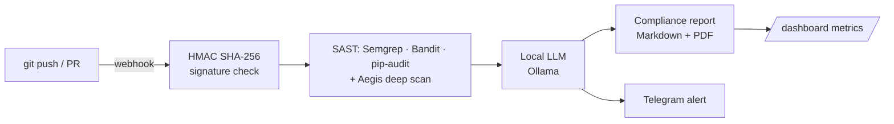

# Commit Guardian 🔒

**AI-powered code security audits for government IT projects — fully on-premise.**

Commit Guardian checks every commit the moment it is pushed: a signed GitHub webhook triggers SAST scanning, a **local** LLM (Ollama) separates real vulnerabilities from noise, and the team gets a Telegram alert plus a formal audit report. Source code never leaves your servers.



---

## 🏛 Gov Tech Benefits

| | |
|---|---|
| **Air-gapped by default** | All AI inference runs on a local Ollama model. Cloud providers (OpenRouter, Gemini) are **disabled unless `ALLOW_CLOUD_LLM=true` is set explicitly** — even if an API key is present in the environment, it is ignored. The dashboard and reports load nothing from the internet, so the whole system works inside a closed network. |
| **Compliance reporting** | Every audited commit — including clean ones — produces a timestamped Markdown + PDF report: repository, branch, commit hash, author, severity breakdown, every triggered SAST rule (file, line, CWE) and the AI's risk assessment. A durable audit trail for internal security reviews and regulators. |
| **Data sovereignty** | Code is cloned into a temporary directory, scanned and deleted. Reports, metrics (SQLite) and the model all stay on your infrastructure; no third-party SaaS is involved. |
| **Tamper-proof triggers** | GitHub webhooks are verified with HMAC SHA-256 (`hmac.compare_digest`). In `ENVIRONMENT=production`, unsigned webhooks are rejected outright. |
| **No human bottleneck** | Every push and pull request is audited automatically, 24/7, within the same pipeline — no waiting for a manual code review to catch leaked secrets or injections. |
| **SIEM-ready operations** | Structured logging with optional JSON output (`LOG_FORMAT=json`) and automatic masking of tokens and passwords in every log line. |

---

## ✨ Features

- **Commit Guardian webhook** — `push` and `pull_request` events, HMAC-verified, processed in a background queue.
- **Multi-engine SAST** — Semgrep, Bandit, pip-audit, secret detection, mobile/Flutter rules and the Aegis deep agentic scanner, merged and de-duplicated.
- **Local AI analysis** — false-positive filtering and an executive risk summary (in Russian) from the local model, with a rule-based fallback when Ollama is offline.
- **Compliance reports** — `reports/<owner>__<repo>/<timestamp>_<commit>.md` and `.pdf` (Cyrillic-ready).
- **Observability dashboard** — `GET /dashboard`: total scans, critical vulnerabilities found, average AI processing time, recent audits; auto-refreshes every 10 s.
- **Telegram alerts** — severity breakdown, top findings and the report reference, sent the moment risk is detected.
- **DAST** — HTTP security headers, CORS, cookie flags and safe active probes for live URLs; Playwright-based XSS proof-of-concept verification.
- **GitHub Action** — run the scanner in CI and publish SARIF to the GitHub Security tab (`action.yml`).

---

## 🚀 Quick Start

**Requirements:** Python 3.11+, Git, [Ollama](https://ollama.com).

```bash
git clone https://github.com/madiyarmoldakhmet-ai/cybersecyritybot.git
cd cybersecyritybot
python -m venv .venv && source .venv/bin/activate
pip install -r requirements.txt
cp .env.example .env            # then fill in TELEGRAM_BOT_TOKEN, GITHUB_WEBHOOK_SECRET, ...
ollama pull qwen2.5-coder:14b
uvicorn aegis_server.main:app --port 8000
```

Open **http://localhost:8000/dashboard**.

### Connect a repository

In the GitHub repository: **Settings → Webhooks → Add webhook**

| Field | Value |
|---|---|
| Payload URL | `https://<your-host>/api/v1/webhook/github` |
| Content type | `application/json` |
| Secret | the value of `GITHUB_WEBHOOK_SECRET` |
| Events | *Pushes* and *Pull requests* |

### Docker

```bash
docker build -t commit-guardian .
docker run -p 8000:8000 --env-file .env \
  -e OLLAMA_BASE_URL=http://host.docker.internal:11434 \
  -v "$PWD/reports:/app/reports" -v "$PWD/data:/app/data" \
  commit-guardian
```

The image bundles the frontend, API, Telegram bot, `git` and a Cyrillic font for PDF reports. Mount `reports/` and `data/` to keep audit reports and metrics across container restarts. See [DEPLOY.md](DEPLOY.md) for Railway / Render.

---

## ⚙️ Configuration

All settings are environment variables (see [`.env.example`](.env.example)). The most important:

| Variable | Default | Purpose |
|---|---|---|
| `ENVIRONMENT` | `development` | `production` makes `GITHUB_WEBHOOK_SECRET` mandatory |
| `GITHUB_WEBHOOK_SECRET` | — | HMAC secret shared with GitHub |
| `TELEGRAM_BOT_TOKEN` / `DEFAULT_TELEGRAM_CHAT_ID` | — | Bot and chat for alerts |
| `OLLAMA_BASE_URL` / `OLLAMA_MODEL` | `http://localhost:11434` / `qwen2.5-coder:14b` | Local model |
| `ALLOW_CLOUD_LLM` | `false` | Opt-in for OpenRouter/Gemini; keep `false` for air-gapped deployments |
| `SCAN_OUTPUT_DIR` | `./reports` | Where compliance reports are written |
| `REPORT_PDF_ENABLED` | `true` | PDF copy next to every Markdown report |
| `METRICS_DB_PATH` | `./data/commit_guardian.db` | SQLite metrics behind `/dashboard` |
| `LOG_LEVEL` / `LOG_FORMAT` | `INFO` / `text` | `json` for SIEM ingestion |
| `CORS_ALLOW_ORIGINS` | — | Extra browser origins (wildcards are never allowed) |

---

## 🔌 API

| Method | Path | Description |
|---|---|---|
| `POST` | `/api/v1/webhook/github` | GitHub webhook receiver (push, pull_request, ping) |
| `GET` | `/dashboard` | Observability dashboard |
| `GET` | `/api/v1/dashboard/metrics` | Dashboard metrics as JSON |
| `GET` | `/api/v1/metrics` | Queue and Ollama concurrency metrics |
| `GET` | `/health` | Health, Ollama connectivity, air-gap status (`web.api` app) |
| `POST` | `/api/v1/scan/sast` · `/api/v1/scan/dast` | On-demand scans (`web.api` app) |

Interactive docs: `/docs`.

---

## 🛡 Security Model

- **Local-only AI policy** is enforced in configuration: without `ALLOW_CLOUD_LLM=true`, the provider is forced to Ollama and cloud keys are dropped at startup (logged as a warning).
- **Webhook authenticity** via HMAC SHA-256 with constant-time comparison; required in production.
- **Secrets never reach logs** — configured tokens, GitHub/OpenAI-style keys and credentials in clone URLs are masked by a logging filter.
- **Untrusted input handling** — repository names from webhooks are sanitised before being used in file paths and HTML-escaped on the dashboard; the dashboard ships a strict Content-Security-Policy.
- **No error detail leakage** — unhandled errors return an opaque `error_id`; details stay in the server log.
- **Ephemeral checkouts** — cloned code is deleted after every audit; a failed clone is reported as a failure, never as a clean scan.

---

## 🧪 Testing

```bash
pip install pytest pytest-asyncio
pytest
```

The suite covers the webhook pipeline end-to-end (with mocked scanners), report generation, the dashboard, metrics persistence and the hardening rules above.

---

## 📁 Project Structure

```
aegis/
  ai/            local AI: audit summaries, remediation
  core/          config & local-LLM policy, logging, queue, metrics store
  reporting/     Markdown + PDF compliance reports
  scanners/      SAST, secrets, mobile, DAST, AI false-positive filter
aegis_server/    production FastAPI app (Docker entrypoint)
web/             webhook receiver, dashboard, REST API
bot/             Telegram bot
aegis_web/       Next.js frontend
tests/           pytest suite
```

## 📝 License

MIT — see [LICENSE](LICENSE).

---

Built by [Madiyar Moldakhmet](https://github.com/madiyarmoldakhmet-ai) · madiyarmoldakhmet@gmail.com
